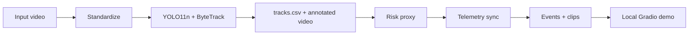

# DashGuard

DashGuard는 대시캠 영상의 도로 객체를 탐지·추적하고 설명 가능한 영상 기반 risk proxy로 사람이 먼저 검토할 experimental event candidate를 만드는 로컬 prototype이다.

## 1. 프로젝트 범위

긴 대시캠 영상을 처음부터 끝까지 보는 대신, 차량·보행자 등 주요 객체의 화면상 변화와 선택적 차량 주행 정보를 시간축에 맞춰 검토 우선 구간을 찾는 것이 목적이다.

**Risk proxy**는 bbox 면적·증가율·화면 중심·ROI를 결합한 휴리스틱 점수다. 실제 거리, TTC 또는 물리적 안전 확률이 아니며 보험·법률 판단이나 차량 제어에 사용하지 않는다.

입력은 최대 30초의 로컬 video와 선택적 telemetry CSV다. 주요 출력은 주석 영상, `tracks.csv`, risk·telemetry plot, event 목록과 clip이다.

## 2. 주요 기능

- FFmpeg/ffprobe 기반 video metadata 검사와 CFR 30 fps 표준화
- YOLO11n PyTorch CPU 도로 객체 탐지
- Ultralytics ByteTrack wrapper 기반 frame 간 track ID 기록
- bbox 기반 visual risk feature와 risk proxy score
- 선택적 telemetry schema validation 및 timestamp sync
- score threshold 기반 event 후보와 clip 생성
- run별 격리 output과 localhost Gradio UI
- ONNX Runtime CPU consistency·single-image benchmark
- 사람 label과 pipeline event candidate의 일대일 시간 구간 평가
- Annotated video 기반 5-candidate manual ID audit

## 3. 아키텍처



전체 실행·평가 흐름, package 경계, output 보호 정책과 PyTorch/ONNX 경계는 [architecture.md](docs/architecture.md)에 정리돼 있다.

## 4. 로컬 데모

저장소 root의 Windows PowerShell에서 실행한다.

```powershell
python scripts/day8_gradio_demo.py
```

기본 주소는 `http://127.0.0.1:7860`이며 localhost에만 bind하고 `share=False`로 실행한다.

- 입력 video는 최대 30초다.
- Backend는 PyTorch CPU이고 기본 model은 `yolo11n.pt`다.
- Telemetry CSV는 선택 입력이며 미입력 시 고정 규칙의 예시 telemetry를 사용한다.
- 주석 영상, risk·telemetry plot, event 표, 첫 clip과 전체 clip 목록을 보여 준다.
- 결과는 `outputs/day8/runs/<run_id>/`에 격리되고 UI에는 `published/` copy만 제공한다.

Local `outputs/`는 생성 산출물 workspace이며 GitHub 문서 경로가 아니다. 기존 run을 덮어쓰지 않고 실패 summary를 해당 run에 보존한다.

## 5. 설치

기준 환경은 Windows, Python 3.11, CPU와 별도 설치한 FFmpeg다.

```powershell
py -3.11 -m venv .venv
.\.venv\Scripts\Activate.ps1
python -m pip install -r requirements.txt
```

```powershell
winget install --id Gyan.FFmpeg -e --source winget
ffmpeg -version
ffprobe -version
```

`requirements-lock.txt`는 검증 환경의 exact package baseline이고 `requirements.txt`는 직접 설치용 pinned set이다.

## 6. 실행

환경과 전체 test:

```powershell
python -m pip check
python -m pytest -q
```

YOLO image smoke test:

```powershell
curl.exe -L "https://ultralytics.com/images/bus.jpg" -o "data/raw/bus.jpg"
python -c "from ultralytics import YOLO; YOLO('yolo11n.pt'); print('model_load: OK')"
python scripts/yolo_smoke.py
```

원본 image, model weight와 생성 output은 Git에 포함하지 않는다.

## 7. 데이터와 모델

- Day 9 도로 영상: `Calm City Drive at Daytime`, creator `Jabriel`, platform `Pexels`, recorded license `Pexels License`. 원본 URL과 license snapshot은 저장소에 없다.
- BDD100K: Detection 2020 구조를 확인하고 train 10장·val 10장 sample, 총 20장·199 bbox를 YOLO 형식으로 변환했다. 정식 training이나 model 성능 평가는 수행하지 않았다.
- Model: pretrained `yolo11n.pt`를 detection·tracking에 사용하며 이 project에서 학습하지 않았고 weight는 commit하지 않는다.
- ONNX: `yolo11n.pt`에서 local FP32 export한 `yolo11n_fp32_opset20_640.onnx`를 consistency·benchmark에만 사용한다.

공식 dataset 원본과 local 제3자 archive를 같은 출처로 취급하지 않는다. 영상·dataset·model의 상세 provenance와 배포 전 재확인 항목은 [data_model_provenance.md](docs/data_model_provenance.md)를 따른다.

## 8. Risk proxy

Risk proxy는 track별 bbox area, area growth, 화면 중심 근접도, ROI 여부를 정규화·가중 결합한다. Monocular pixel 변화만 보기 때문에 차량 회전, 화면 경계 진입, 측면 통과, ego-motion, 작은 객체의 detection 변동에도 높은 값이 나올 수 있다.

Day 5의 feature·score 계약과 검증은 [day5_risk_proxy_validation.md](docs/day5_risk_proxy_validation.md)에 기록돼 있다.

## 9. Telemetry

**Synthetic telemetry**는 실제 GPS·IMU·OBD 대신 integration, schema, timestamp sync와 plot을 확인하기 위해 고정 규칙으로 만든 예시 데이터다. 실제 센서 정확도나 운전 상태의 근거가 아니며 현재 risk score에 반영되지 않는다.

실제 CSV를 제공할 때는 timestamp 단조 증가, 유한한 speed·acceleration과 tolerance 내 sync를 검증한다. 상세 계약은 [day6_telemetry_event_validation.md](docs/day6_telemetry_event_validation.md)를 참고한다.

## 10. Event 생성

Frame risk score가 threshold 이상인 연속 구간을 minimum duration과 merge gap 계약에 따라 event candidate로 만든다. Preview clip에는 pre/post-roll을 적용하되 원 event interval은 보존한다.

Day 9에서 **ground truth**는 사람이 정답으로 동결한 event 구간이고 **prediction**은 pipeline이 만든 후보 구간이다. **Temporal IoU**는 두 시간 구간의 교집합 길이를 합집합 길이로 나눈 값이다.

**TP**는 matching label이 있는 prediction, **FP**는 matching label이 없는 prediction, **FN**은 matching prediction이 없는 label이다. **Precision**은 prediction 중 TP 비율이고 **Recall**은 label 중 TP 비율이다.

## 11. ONNX

FP32 opset 20 export, 두 BDD100K sample image의 CPU output consistency와 제한된 single-image benchmark를 완료했다. 현재 full-video Gradio workflow는 계속 PyTorch CPU이며 ONNX full-video tracking backend는 구현하지 않았다.

단일 image inference benchmark에는 video decode, tracking, overlay, risk, telemetry, event·clip 단계가 포함되지 않는다. 자세한 범위는 [day7_onnx_cpu_benchmark_validation.md](docs/day7_onnx_cpu_benchmark_validation.md)에 있다.

## 12. Pilot evaluation

Day 9은 **single-source small-sample pilot**이다. 같은 원본의 세 비중복 segment를 사용했으므로 독립 원본 수는 1이다.

Positive label이 0개인 header-only label CSV와 별도로 reviewed-video scope CSV를 동결해 세 segment의 ID·SHA-256·duration을 보존했다. [Day 9 evaluator CLI](scripts/day9_evaluate_events.py)는 `--label-scope-csv`를 필수로 받아 scope와 prediction video set·duration을 먼저 검증한다.

| 평가 항목 | 결과 | 해석 |
|---|---:|---|
| 독립 원본 | 1 | 단일 원본 pilot |
| 평가 segment | 3 | 각 27.5초 |
| GT positive | 0 | Recall 측정 불가 |
| 예측 event | 7 | 사람 검토 대상 |
| 확인된 FP | 7 | Precision 0.0 |
| ID 후보 | 5 | 수동 표본 |
| 확정 ID switch | 0 | 전체 tracker 보장 아님 |
| duplicate episode | 21 | 3개 후보에서 관찰 |
| pytest | 641 passed | 현재 로컬 환경 |

Primary IoU 0.30과 sensitivity 0.50 모두 TP 0, FP 7, FN 0, Precision 0.0, Recall `null`이다. Positive label이 없어 threshold 차이는 결과에 영향을 주지 않았고 positive 탐지 능력은 측정하지 못했다.

**ID switch**는 사람이 따라간 실제 객체의 primary ID가 다른 번호로 교체되는 현상이다. **Duplicate track**은 같은 실제 객체 위에 둘 이상의 ID가 동시에 보이는 후보 현상이고, **fragmentation**은 한 객체 track이 여러 조각 또는 ID로 나뉠 가능성을 뜻한다. 검토한 5개 후보에서는 확정 ID switch가 관찰되지 않았지만, 3개 후보에서 총 21개 duplicate/fragmentation episode가 관찰됐다. 공식 IDF1 또는 HOTA 결과가 아니다.

전체 계약·run 수치·사람 검토·제한은 [day9_pilot_evaluation_validation.md](docs/day9_pilot_evaluation_validation.md)에 있다.

## 13. 실패 사례

Human-reviewed FP에서 반복된 패턴은 다음과 같다.

- 정상 좌회전 때 bbox 외형·면적이 빠르게 변함
- 화면 경계의 부분 차량이 전체 차량로 나타남
- 원거리 소형 vehicle bbox가 불안정함
- 차량 간 가림 순간에 불안정 detection이 생김
- 정상 측면 차량 통과를 접근으로 해석함
- 자차 우회전과 camera ego-motion이 전방 접근처럼 표현됨
- 하나의 정상 통과가 인접 event 두 개로 나뉨

Ultralytics가 detection은 있지만 확정 ID가 없는 frame에서 `boxes.id=None`을 반환해 segment 3 첫 실행이 실패한 integration bug도 확인했다. Wrapper가 이 frame을 확정 track 0개로 처리하도록 최소 수정했으며 strict converter와 다른 validation은 유지했다.

## 14. 한계

- 독립 도로 원본 1개, segment 3개, 총 82.5초의 negative-only 표본이다.
- 야간, 악천후, 강한 camera shake, 보행자 중심 장면, 급박한 positive를 평가하지 않았다.
- Ground-truth positive가 없어 Recall과 positive 탐지 능력을 평가하지 못했다.
- ID audit는 실제 차량 후보 5개에 한정되고 class 변화는 사람이 완전 계수하지 않았다.
- 실제 telemetry, 거리, TTC, 운전자 행동 또는 안전 성능을 검증하지 않았다.
- PyTorch CPU full pipeline은 30 FPS 처리를 보장하지 않는다.
- Reviewer 1명의 label·prediction review이며 여러 독립 reviewer 일치도를 측정하지 않았다.

## 15. 향후 개선

- Positive와 negative가 모두 있는 여러 독립 원본으로 평가 확대
- Optical flow 또는 ego-motion 보정 가능성 검토
- 경계 출현 객체 warm-up, 최소 observation 수, track age 조건 검토
- Bbox growth의 robust smoothing과 lateral/forward motion 분리 검토
- Event refractory period 또는 인접 event 병합 계약 재검토
- 실제 telemetry가 확보되면 별도 calibration·sync 검증
- MOT용 정답 ID가 있는 dataset에서 공식 tracking metric 평가
- ONNX full-video tracking integration의 별도 설계·검증

이 항목들은 계획 또는 검토 방향이며 구현 완료를 뜻하지 않는다.

## 16. 라이선스·출처

현재 저장소에는 project-level `LICENSE` 파일이 확인되지 않는다. BDD100K data, 실제 도로 영상, pretrained model weight와 파생 ONNX artifact는 source code 및 dependency와 별도 조건을 가질 수 있다.

현재 저장소에 근거가 부족한 상업적 사용 가능 여부를 단정하지 않는다. 외부 배포 전 [data_model_provenance.md](docs/data_model_provenance.md)의 checklist에 따라 원 URL, license snapshot, attribution, weight와 파생 artifact 조건을 다시 확인한다.

## 17. 검증 기록

- [Day 5 risk proxy](docs/day5_risk_proxy_validation.md)
- [Day 6 telemetry and events](docs/day6_telemetry_event_validation.md)
- [Day 7 ONNX CPU](docs/day7_onnx_cpu_benchmark_validation.md)
- [Day 8 Gradio integration](docs/day8_gradio_integration_validation.md)
- [Day 9 event labeling guide](docs/day9_event_labeling_guide.md)
- [Day 9 pilot evaluation](docs/day9_pilot_evaluation_validation.md)
