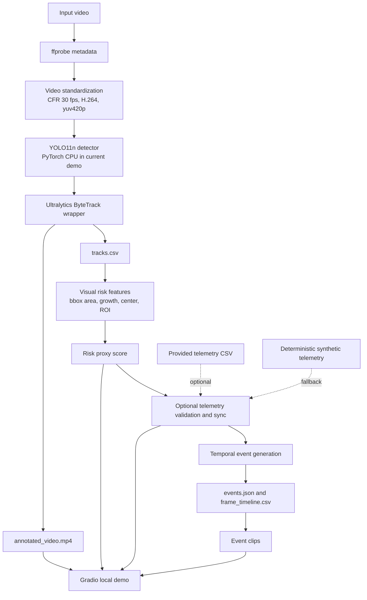
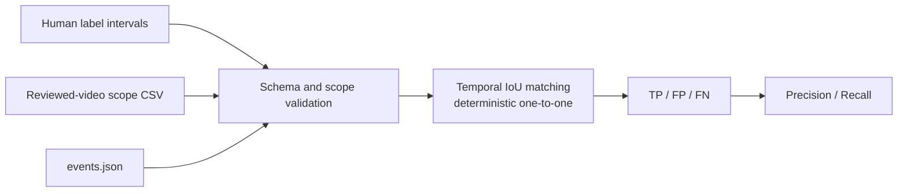
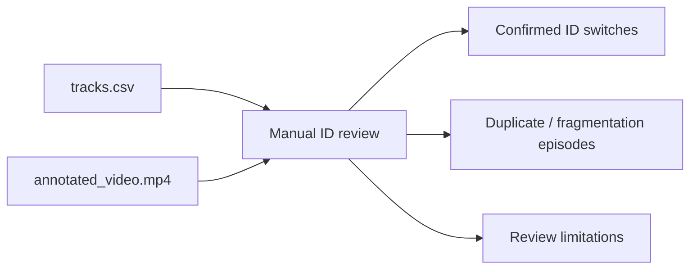

# DashGuard Architecture

## 1. 범위

DashGuard는 짧은 대시캠 영상을 표준화하고, 도로 객체를 탐지·추적한 뒤, 영상 기반 risk proxy와 선택적 telemetry를 시간축에 맞춰 experimental event candidate와 clip으로 만드는 로컬 prototype이다. Risk proxy는 영상 휴리스틱이며 실제 거리, TTC 또는 물리적 안전 확률이 아니다.

현재 full-video Gradio workflow의 backend는 PyTorch CPU다. ONNX FP32 export와 CPU consistency/benchmark는 별도 정적 이미지 경로에서 완료했지만 ONNX full-video tracking backend는 구현하지 않았다.

## 2. 실행 흐름

`ffprobe` metadata는 입력 duration·fps·dimension의 preflight와 표준화 결과 확인에 사용한다. Detector와 tracker는 매 frame의 대상 객체를 `Track` record로 바꾸고, 주석 영상과 `tracks.csv`를 만든다. Risk 단계는 track bbox의 화면상 변화만 사용한다. Telemetry는 score에 직접 들어가지 않고 별도 동기화·표시·event context 경로에 놓인다.

## 3. 평가 흐름

**Ground truth**는 사람이 정답으로 동결한 event interval이고 **prediction**은 pipeline이 만든 후보 interval이다. **Temporal IoU**는 두 시간 구간의 교집합을 합집합으로 나눈 값이다.

**TP**는 matching label이 있는 prediction, **FP**는 matching label이 없는 prediction, **FN**은 matching prediction이 없는 label이다. **Precision**은 prediction 중 TP 비율이고 **Recall**은 label 중 TP 비율이다.

Tracking identity 평가는 event matching과 분리한다.

**ID switch**는 사람이 따라간 실제 객체의 primary track ID가 다른 번호로 교체되는 현상이다. **Duplicate track**은 같은 객체 위에 둘 이상의 ID가 동시에 표시되는 후보 현상이고, **fragmentation**은 한 객체의 track이 여러 조각 또는 ID로 분리될 가능성을 뜻한다.

## 4. 주요 입력과 출력

| 단계 | 주요 입력 | 주요 출력 |
|---|---|---|
| preflight·standardization | video file | metadata, `input/standardized_input.mp4` |
| detection·tracking | standardized frames, `yolo11n.pt` | `analysis/tracks.csv`, `analysis/annotated_video.mp4`, `analysis/metrics.json` |
| risk | `tracks.csv`, standardized video | `risk/risk_scores.csv`, `risk/risk_proxy.png` |
| telemetry | optional telemetry CSV 또는 synthetic fallback | `input/synthetic_telemetry.csv`, `telemetry/risk_telemetry_sync.csv`, plot |
| events | synchronized timeline | `events/events.json`, `events/frame_timeline.csv` |
| clips | `events.json`, standardized video | `clips/clip_manifest.json`, event MP4 files |
| presentation | annotated video, plots, events, clips | `published/` copies와 local Gradio view |
| temporal evaluation | frozen label CSV, reviewed-video scope CSV, `events.json` | scoped evaluation report JSON |
| manual ID review | `tracks.csv`, annotated video | worksheet, timecode observations, summary |

`outputs/`는 실행 때 생성되는 local workspace이며 Git 배포 파일이 아니다. 영상, 모델 weight, CSV·JSON 결과는 `.gitignore` 정책에 따라 기본적으로 버전 관리에서 제외한다.

## 5. Source package 경계

| package | 책임 |
|---|---|
| `dashguard.video` | metadata probe, frame reading, standardization, overlay, event clip extraction |
| `dashguard.detection` | Ultralytics detector adapter와 detection value type |
| `dashguard.tracking` | ByteTrack wrapper, strict result conversion, track value type |
| `dashguard.analysis` | tracked-video orchestration, risk features·score·report, telemetry, events |
| `dashguard.inference` | PyTorch/ONNX output consistency와 CPU benchmark 지원 |
| `dashguard.demo` | local Gradio UI, presentation, isolated full-video workflow |
| `dashguard.evaluation` | Day 9 label/prediction validation, temporal IoU matching, metric report |
| `dashguard.data` | BDD100K Detection 2020 label-to-YOLO conversion 지원 |
| `scripts/` | 위 package를 호출하는 얇은 CLI entry point |

UI와 CLI는 계산 규칙을 다시 구현하지 않고 package API를 호출한다. `dashguard.evaluation`은 label·scope·prediction validation과 temporal matching 계약을 제공하며 CLI는 이 public API를 조합한다.

## 6. Run workspace와 output 보호

각 demo run은 `outputs/day8/runs/<run_id>/` 또는 명시한 별도 output root 아래의 새 directory에서 실행된다. Preflight는 기존 run ID를 거부하고, JSON은 임시 파일을 flush한 뒤 atomic replace로 완성하며, 기존 최종 경로가 있으면 기본적으로 덮어쓰지 않는다.

성공 시 브라우저가 읽는 artifact는 `published/`에 exclusive copy하고 원본·copy SHA-256 일치를 확인한다. 실패 시 생성된 artifact 목록, 실패 stage, 예외와 traceback을 해당 run의 `run_summary.json`에 보존한다. 다른 성공 run이나 기존 published artifact는 교체하지 않는다.

## 7. Tracking adapter 경계

Ultralytics는 detection이 있어도 ByteTrack이 아직 확정 ID를 부여하지 않은 frame에서 `boxes.id=None`을 반환할 수 있다. `UltralyticsByteTracker.track()`은 이 정상 adapter 경계를 확정 track 0개로 반환한다.

Strict `convert_ultralytics_result()`는 직접 호출 시 detection과 함께 `boxes.id=None`이면 계속 오류를 내며, 좌표 행 길이, 배열 길이, class name, positive track ID, bbox·confidence 변환 validation도 유지한다. 이 구분은 tracker quality 변경이 아니라 외부 library 결과를 workflow 계약으로 안전하게 번역하는 통합 경계다.

## 8. Risk proxy와 telemetry 경계

Risk proxy는 bbox 면적, 면적 증가율, 화면 중심 근접도, ROI 여부를 정규화·가중 결합한다. Monocular camera의 pixel 변화에 민감하므로 회전, 경계 진입, 측면 통과, ego-motion, 작은 객체 검출 변동에도 높은 값이 나올 수 있다.

**Synthetic telemetry**는 실제 센서가 없을 때 deterministic한 speed·acceleration series를 만드는 통합 fixture다. Schema, timestamp sync, plot, event context를 검증할 뿐 실제 GPS·IMU·OBD 측정이나 운전 상태의 근거가 아니다. 현재 score는 telemetry 값에 의해 조정되지 않는다.

## 9. ONNX 경계

| 항목 | 현재 상태 |
|---|---|
| FP32 export | `yolo11n.pt`에서 `yolo11n_fp32_opset20_640.onnx` 로컬 export 완료 |
| CPU consistency | 두 BDD100K sample 이미지에서 raw output·post-NMS detection 비교 완료 |
| CPU benchmark | PyTorch CPU와 ONNX Runtime CPU의 제한된 single-image benchmark 완료 |
| full-video Gradio workflow | PyTorch CPU |
| ONNX full-video tracking backend | 미구현 |

ONNX 단일 이미지 benchmark는 video decode, tracking, overlay, risk, telemetry, event·clip 생성까지 포함하지 않는다. 따라서 full pipeline 처리 특성으로 해석하지 않는다.

## 10. 관련 문서

- [Day 5 risk proxy validation](day5_risk_proxy_validation.md)
- [Day 6 telemetry and event validation](day6_telemetry_event_validation.md)
- [Day 7 ONNX CPU validation](day7_onnx_cpu_benchmark_validation.md)
- [Day 8 Gradio integration validation](day8_gradio_integration_validation.md)
- [Day 9 pilot evaluation](day9_pilot_evaluation_validation.md)
- [Data and model provenance](data_model_provenance.md)
